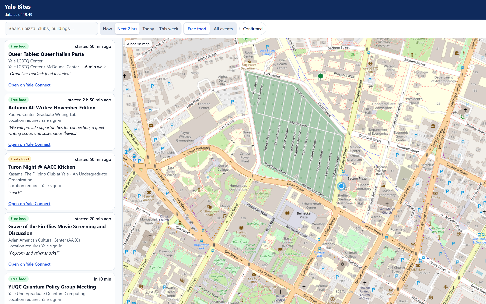
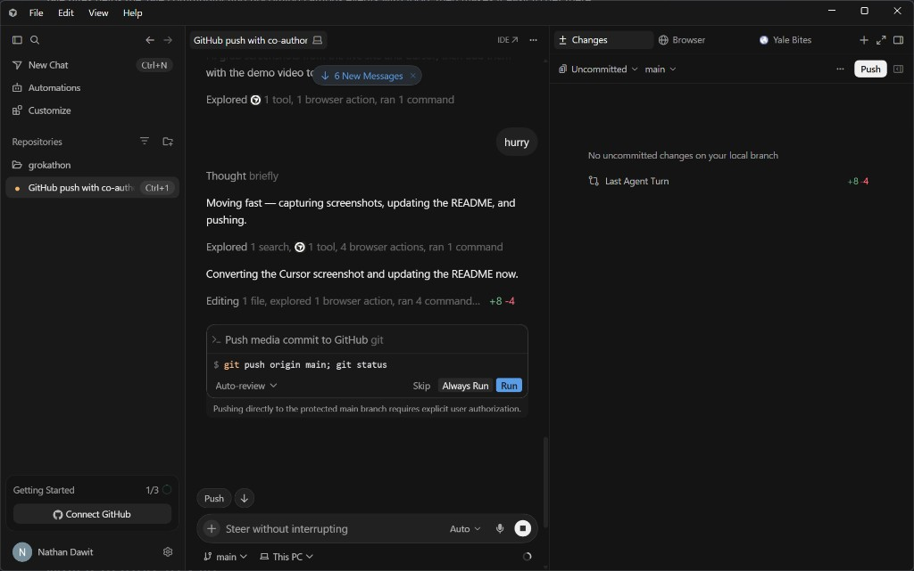
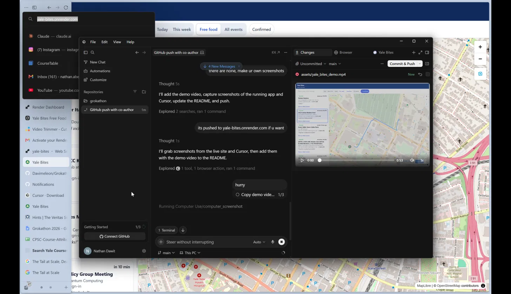

# Yale Bites

**Find food. Meet Friends. Explore Yale.**

Deployed Website: https://yale-bites.onrender.com/

Yale Bites helps the Yale community find, search, and get to upcoming campus events with food by scraping YaleConnect events with a food likelihood detection model.

## A. Demo video

[](https://github.com/Davimeleon/Grokathon2026_YaleBites/blob/main/assets/yale_bites_demo.mp4)

[Watch the 1-minute demo](https://github.com/Davimeleon/Grokathon2026_YaleBites/blob/main/assets/yale_bites_demo.mp4) — opens GitHub’s video player (does not download). Live app: [yale-bites.onrender.com](https://yale-bites.onrender.com).

## B. Screenshot: Built with Cursor and Grok





Yale Bites was built in Cursor (agent workflow above). Live UI poster: `assets/yale-bites-app.png`.

## What Yale Bites does

Yale Connect brings together events from across campus, but finding one with food at the right time can mean
opening and reading many separate listings. Yale Bites turns those listings into a searchable, time-aware map
and event list. Start with food events in the next two hours, or switch to events happening now, today, or this
week. Search by food, club, or building; narrow the results to confirmed food; and open the original Yale
Connect listing for event details.

When an event has a known location, Yale Bites can show its map pin and an estimated walk from your position.
Select an event to see a walking route, or open directions in Google Maps.

## How it works

Yale Bites collects upcoming Yale Connect listings and reads each event's title, description, organizer-provided
food information, time, and location. Its evidence-based scoring model looks for signs of food, including the
organizer's **food included** flag and phrases in the listing. It classifies events as **free food**, **likely
food**, or **no food listed**, while keeping the supporting text so the result is explainable. The classifier
is a transparent, lexicon-driven scoring model with editable rules and weights.

The app refreshes its data regularly, stores normalized events, and serves the same results to the map and list.
Search and time filters help students find relevant events quickly. A Yale building gazetteer and geocoding
resolve locations when possible; Yale Connect's sign-in restrictions are respected when a location is hidden.

## Why it matters to Yale

Free food can be a practical reason to step into an event, but the value extends beyond a meal. A student looking
for lunch might discover a new organization, attend a talk, or meet people outside their usual circles. Yale
Bites gives campus groups another path to interested attendees and helps students make use of events already
happening around them. By putting time, food information, and walking directions in one place, it makes those
opportunities easier to find and act on.

For the implementation details:

* `docs/sources.md`: what Yale Connect exposes, measured, with evidence and the source ranking.
* `docs/api.md`: the HTTP API.
* `tests/data/fixtures/`: recorded real responses (the interface contract every test runs against).

## Quick start

```bash
make install          # uv sync + npm ci (web)
make web              # build the frontend into web/dist
make seed             # load the recorded fixtures into var/yale_bites.sqlite3 (offline)
make test             # full test suite (offline, hermetic)
uv run app            # API + frontend on http://127.0.0.1:8000, live sync every 3 / 30 min
uv run app --no-sync  # serve the seeded database without touching the network
```

`make seed` replays the recorded fixtures through the real sync pipeline and shifts them by whole days so
the capture date lines up with today, so the default "free food in the next 2 hours" view has data. `/api/meta`
reports `dataset.kind = "fixture_replay"` until the first live sync replaces it.

## Under the hood

Yale Bites turns Yale Connect listings into a useful answer to a simple question: **Where can I find food soon?**

1. **Collect events.** The backend reads upcoming events from Yale Connect's CampusGroups GraphQL API, which
   includes descriptions, locations, and the organizer's *food included* flag. A calendar feed helps track event
   IDs and updates. Frequent refreshes keep the next few hours current, while change detection avoids repeatedly
   processing the same listings.
2. **Estimate food likelihood.** Our rule-based scoring model weighs the organizer's flag alongside clues in
   titles, descriptions, and food details. It also accounts for misleading mentions of food. Each event receives
   a **yes**, **likely**, or **no** label, and matched text is shown as evidence. On a hand-labeled set of 250
   real events, the **yes** label reached **99.2% precision** (130 correct out of 131 predictions).
3. **Make the data searchable.** A Python backend built with FastAPI stores cleaned events in SQLite and serves
   filters for time, food likelihood, search terms, and distance. Location matching places events on the map when
   Yale Connect provides enough information.
4. **Help people get there.** The TypeScript frontend, built with Vite and MapLibre, keeps the event list and map
   in sync. With location permission, it shows nearby events and walking times. A public OpenStreetMap pedestrian
   routing service draws walking routes, and a Google Maps link opens turn-by-turn directions.

## Authenticated mode (optional)

Anonymous Yale Connect withholds about 74% of event locations ("Sign in to download the location") and every
members-only event. To include them, supply your own browser session at runtime:

```bash
export YALECONNECT_COOKIE='<the whole Cookie header from a signed-in yaleconnect.yale.edu tab>'
export YALECONNECT_ICS_FEEDS='<your personal feed URL from /ics_helper>'   # optional, comma-separated
make demo-auth        # validates the session, runs one full sync, prints anonymous vs authenticated counts
uv run app
```

* Get the cookie from DevTools → Network → any request to `/api/v2/graphql` → Request Headers → `cookie`.
* Credentials are read from the environment only. They are never written to disk, logged, or returned by the
  API, and they are sent only to `yaleconnect.yale.edu`, never to CAS or the CDN. A test greps all log output
  from a full sync for them.
* An expired session (CAS redirect, login page, `AUTH_NOT_AUTHENTICATED`, or an event-count collapse) logs one
  warning naming `YALECONNECT_COOKIE`, and the run falls back to anonymous with `auth_status = expired`.
  `make demo-auth` exits non-zero with instructions so a dead cookie shows up before a demo.
* We do **not** script the CAS login, store passwords, or spoof the browser-only OIDC endpoint (see
  `docs/sources.md` §4).

## Using the map

* The page asks for your location when it loads (the map's ◎ button asks again or recenters). With a position,
  the list shows walking times and sorts by distance.
* Tap an event (card or pin) to draw the **walking route** to it, Google-Maps style, with time and distance;
  "Google Maps" opens turn-by-turn directions. Routes come from the public OpenStreetMap pedestrian router at
  `routing.openstreetmap.de`, so your position and the destination are sent there when you select an event. If it
  is unreachable, a dashed straight line with an estimate is shown instead.

## Configuration

| variable | default | meaning |
|---|---|---|
| `YALECONNECT_COOKIE` | – | session cookie header (authenticated mode) |
| `YALECONNECT_ICS_FEEDS` | – | comma-separated per-user ICS feed URLs |
| `YALE_BITES_CONTACT` | `operator@example.invalid` | contact string in the User-Agent |
| `YALE_BITES_VAR_DIR` | `./var` | DB, raw-response caches, Nominatim cache |
| `YALE_BITES_DB` | `$YALE_BITES_VAR_DIR/yale_bites.sqlite3` | database file |
| `YALE_BITES_SCHEDULER` | `1` | `0` serves existing data without syncing |
| `YALE_BITES_ONLINE_GEOCODING` | `1` | Nominatim fallback for unknown locations (1 req/s, cached permanently) |
| `YALE_BITES_HOST` / `YALE_BITES_PORT` | `127.0.0.1` / `8000` | bind address |

## Repository layout

| path | contents |
|---|---|
| `app/sources.py` | endpoints, GraphQL documents, id helpers (contract) |
| `app/schemas.py`, `app/db/models.py` | frozen data contracts |
| `app/fetch/`, `app/auth.py`, `app/sync.py`, `app/seed.py` | fetch layer, session handling, scheduler, fixture replay |
| `app/parse/` | GraphQL/ICS parsing, normalization, content hash, upsert |
| `app/enrich/food.py`, `data/food_lexicon.yaml` | free-food scoring classifier and its editable lexicon |
| `app/enrich/geo.py`, `data/buildings.yaml` | Yale gazetteer, fuzzy matching, Nominatim fallback |
| `app/api/` | FastAPI app |
| `web/` | Vite + TypeScript + MapLibre frontend |
| `scripts/record_fixtures.py` | operator-only: re-record live responses |
| `scripts/build_auth_fixtures.py` | builds the hand-constructed authenticated fixtures |

## Measured quality (fixture set, `make test` prints these)

* Free-food classifier, 250 hand-labeled real events. Gold labels came from two blind annotators plus an adjudicator; 2 of 250 disagreements.
  "yes" precision **0.992** (130/131), recall 0.977; "yes+likely" precision 0.965. A separate review of the
  1,007 unlabeled real events found 79 of 81 predicted "yes" correct. Both misses were fixed with general rules and
  regression tests (`tests/test_food_review_fixes.py`).
* Gazetteer: **93.4%** of the 376 distinct `location_raw` values in the fixtures resolve (347 pinned, 4 online/TBD).
  The 25 unresolved are listed by the test; most are out of town (Berlin, Tokyo, NYC, DC).

## Known limitations

* Anonymous Yale Connect withholds the location of about 74% of events, so most cards say "Location requires Yale
  sign-in" and are not on the map until authenticated mode is configured.
* Whether `/api/v2/graphql` accepts the browser session cookie alone (rather than the SPA's OIDC bearer token) could
  not be verified without a real session. `make demo-auth` tells you in one request. Personal ICS feeds work either way.
* Building coordinates in `data/buildings.yaml` were placed by hand. Nominatim and Overpass refused requests from the
  build machine. Spot checks put most within about 100 m.
* The Nominatim fallback (`YALE_BITES_ONLINE_GEOCODING=1`) needs an egress IP that Nominatim accepts. A refusal just
  means no pin; it is never cached as a miss.
